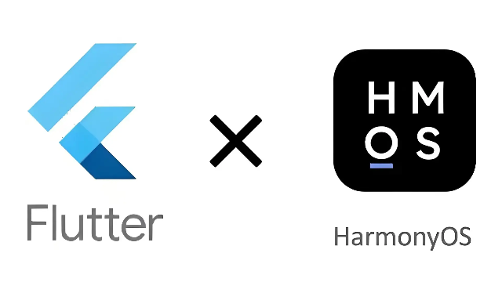
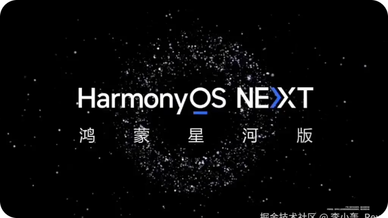

## Hey，我是李小轰 🔅 
 

### 关于我 
- 🔭 `Li Yufeng（李宇峰）｜HDE‑Huawei Developer Expert, OpenHarmony Contributor`
- 🔭 全栈：精通 `Android`、`Flutter`、`HarmonyOS`、`小程序开发` 等，喜欢尝试各种新玩意儿。
- ⚡ `『 华为开发者专家(HDE) 』`、`『 OpenHarmony 三方库贡献者 』`、`『 pub.dev 三方库维护者 』`
-   
 

### 热门解决方案 [🪐](https://juejin.cn/column/7304820397404536870)

<!-- BLOG-POST-LIST:START -->
- [Flutter：双屏插件（客显屏应用场景）](https://juejin.cn/post/7007678468020240414)
- [Flutter：小票标签打印（使用widget开发票据样式的跨平台解决方案)](https://juejin.cn/post/7210688688921395237)
- [Flutter：扫码枪获取数据（多平台适用方案）](https://juejin.cn/post/7186991958638723132)
- [Flutter：电子秤连接、数据获取（适配Android、Windows）](https://juejin.cn/post/7275280984290852923)
- [Flutter：打印模版动态化方案](https://juejin.cn/spost/7301242165278769179)
<!-- BLOG-POST-LIST:END -->
 

### 我的开源项目 [《开源库目录》](project.md)

✨ 热爱技术分享与开源，OpenHarmony 、Pub.dev 活跃贡献者，已发布10余个高质量三方库。
 
- 💡 涉猎：`电商App`、`VR应用`、`智慧城市`、`AI大模型`、`餐饮零售`、`收银POS、自动摇茶机（数字化）`、`鸿蒙纯血` 等。
- 🚀 开源库：`副屏双引擎插件`、`扫码枪跨平台插件`、`小票标签跨平台插件`、`称重插件`、`flutter 动态化` 等。
- 💬`收录POS相关跨平台方案`：https://gitcode.com/cashier
- 博客不定期更文，欢迎交流讨论😎。    [「鸿蒙 NEXT 开发专栏」](https://juejin.cn/column/7344258220389335094)、[「Flutter 开发专栏」](https://juejin.cn/column/7039538334820990983)

 

<!-- 最近更新 -->
### [最近博文更新](https://juejin.cn/user/3157453124930039)
<!--    由工作流定时生成     -->
<!-- rex-platform-posts start -->
<table width="100%">
  <tr>
<td width="33%" valign="top">
       
<a href="https://juejin.cn/post/7701250324648263699" target="_blank">用一个小项目，学会开发 MCP</a>
       
      1天前
    </td>
<td width="33%" valign="top">
       
<a href="https://juejin.cn/post/7698620704770392127" target="_blank">项目要介绍片的话，可以试试这个 Skill</a>
       
      8天前
    </td>
<td width="33%" valign="top">
       
<a href="https://juejin.cn/post/7618601991490306099" target="_blank">【实战篇】老板临时催包？人在外面没电脑，我的龙虾助理直接操办</a>
       
      7个月前
    </td>
  </tr>
  <tr>
<td width="33%" valign="top">
       
<a href="https://juejin.cn/post/7616340145881792550" target="_blank">AI 能做些什么？我给闺女做的第一个AI游戏</a>
       
      7个月前
    </td>
<td width="33%" valign="top">
       
<a href="https://juejin.cn/post/7587254134400270345" target="_blank">把手机变成听诊器！摄像头 30 秒隔空测心率 - 开箱即用</a>
       
      10个月前
    </td>
<td width="33%" valign="top">
       
<a href="https://juejin.cn/post/7586686861390757939" target="_blank">纯算法AEC：播录并行场景的回声消除实战笔记</a>
       
      10个月前
    </td>
  </tr>
  <tr>
<td width="33%" valign="top">
       
<a href="https://juejin.cn/post/7472593190920912934" target="_blank">现有Flutter项目适配鸿蒙：探索跨平台开发的无限可能</a>
       
      1年前
    </td>
<td width="33%" valign="top">
       
<a href="https://juejin.cn/post/7469591708692332570" target="_blank">HarmonyOS：如何实现NFC碰一碰快捷唤起你的应用</a>
       
      1年前
    </td>
<td width="33%" valign="top">
       
<a href="https://juejin.cn/post/7449408933905137691" target="_blank">李宇峰｜全栈开发成长之路：从入门实践到华为开发者专家（HDE），初学者学习指南</a>
       
      1年前
    </td>
  </tr>
</table>
<!-- rex-platform-posts end -->
 

